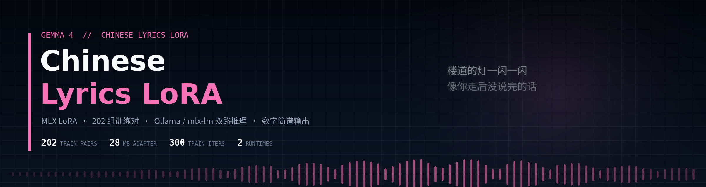
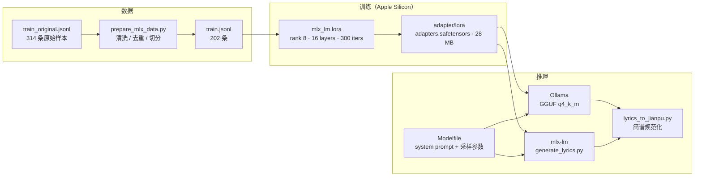

<p align="center">
  
</p>

<p align="center">
  
  
  
  
  
  <a href="LICENSE"></a>
</p>

<p align="center">
  <strong>写中文歌词，也写数字简谱</strong><br>
  <sub>Gemma 4 e4b-it · MLX LoRA · 标签式创作约束 · Ollama 与 mlx-lm 双路推理</sub>
</p>

---

> 一条能跑通的完整链路：数据清洗 → MLX LoRA 微调 → 28 MB 适配器 → Ollama / mlx-lm 双路推理 → 数字简谱。**基座模型不随仓库提供**，训练与评测在 Apple Silicon 上完成。

| 训练对 | 适配器 | 训练步数 | 推理路径 |
| :---: | :---: | :---: | :---: |
| **202** | **28 MB** | **300 iters** | **2 条** |

## 项目简介

通用大模型写中文歌词常见两类问题：要么堆砌空泛意象、句子模板化，要么把「风格」理解成对某位歌手的模仿。

本项目用 LoRA 把 Gemma 4 e4b-it 收窄到一条创作约束上：

- **标签式输入**：`风格：… 情绪：… 场景：… 结构：… 意象：…` 直接作为创作约束，不写成任务说明，也不复述标签；
- **成品而不是片段**：默认输出 5 段完整歌曲（主歌 ×2、副歌、桥段、收束），16–28 行；
- **可转简谱**：要求「简谱」时输出 `1-7 / 0 / - / |` 记谱，第一行带调号与拍号，再接对应歌词；
- **不模仿具体作者**：系统提示明确禁止复刻在世作者、歌手、词人的可识别表达。

## 特性

| 能力 | 实现 |
| --- | --- |
| **风格控制** | 标签解析 + Modelfile 中 18 条系统规则，约束语气、结构与重复 |
| **结构控制** | `generate.sh` / `run_ollama.sh` 按「完整歌曲 / 短片段」改写提示词，并给出最少行数 |
| **数字简谱** | 模型输出简谱与歌词配对，`lyrics_to_jianpu.py` 做格式校验与规范化 |
| **双路推理** | Ollama（GGUF，跨平台）与 mlx-lm（原生 MLX，Apple Silicon） |
| **可复现训练** | `train.sh` 固定 rank / 层数 / 步数 / 学习率；适配器与数据均入库 |
| **共享系统提示** | `Modelfile` 是两路推理共用的系统提示源，避免两套行为漂移 |

## 架构



| 组件 | 作用 |
| --- | --- |
| `data/train_original.jsonl` | 原始样本（314 条），`messages` 格式 |
| `scripts/prepare_mlx_data.py` | 解析、清洗、去重并切分 train / valid / test |
| `scripts/train.sh` | 数据预处理 + `mlx_lm.lora` 训练，产物写入 `adapter/lora/` |
| `Modelfile` | 系统提示、温度 / top_p / top_k / 重复惩罚 / 输出长度 |
| `scripts/generate_lyrics.py` | MLX 直接推理，支持 seed、最少行数、重试与结构模板 |
| `scripts/lyrics_to_jianpu.py` | 把「简谱 + 歌词」输出规范化并校验 |

## 数据

| 划分 | 条数 | 文件 |
| --- | :---: | --- |
| 原始 | 314 | `data/train_original.jsonl` |
| 训练 | 202 | `data/train.jsonl` |
| 验证 | 11 | `data/valid.jsonl` |
| 测试 | 12 | `data/test.jsonl` |

样本为单轮对话，`user` 是创作约束，`assistant` 是歌词正文：

```json
{"messages": [
  {"role": "user", "content": "写一段带有独立音乐气质的歌词\n\n情绪：温柔\n意象：雪\n结构：中短句 + 第一人称 + 段落推进"},
  {"role": "assistant", "content": "我不能再想\n如你所愿我已长大\n……"}
]}
```

## 训练

```bash
python3 -m venv venv && source venv/bin/activate
pip install mlx-lm

# 下载基座模型到 model/gemma4_mlx（或 HF 的 gemma-4-e4b-it 目录）
bash scripts/train.sh
```

| 参数 | 默认值 |
| --- | :---: |
| LoRA rank | 8 |
| 微调层数 | 16 |
| 训练步数 | 300 |
| 学习率 | 5e-5 |
| batch size | 1 |
| max seq length | 512 |
| 适配器大小 | 28 MB |

训练完成后适配器在 `adapter/lora/`，可直接用于两路推理。

## 快速开始

### 方式一：Ollama（推荐）

```bash
# 1. 用 llama.cpp 把基座 + LoRA 量化为 gguf（放到 llama.cpp/ 下）
# 2. 确认 Modelfile 的 FROM 指向量化后的文件
bash scripts/build_ollama.sh

# 3. 生成
bash scripts/run_ollama.sh "写一首关于离别的歌"
bash scripts/run_ollama.sh "风格：冷淡克制 情绪：孤独 场景：夜晚城市"
bash scripts/run_ollama.sh "写一段简谱，风格：民谣"
```

### 方式二：MLX 直接推理

```bash
# 需要把微调后的模型转换为 MLX 格式，放在 model/gemma4_mlx/
bash scripts/generate.sh "风格：后摇 情绪：告别 场景：车站"
bash scripts/generate.sh "简谱，风格：民谣 场景：田野"
```

> `run_ollama.sh` 与 `generate.sh` 会自动识别「简谱 / 数字谱 / 片段」等关键词，改写提示词并追加行数与结构约束。

## 数字简谱模式

- 第一行给出调号与拍号，例如 `1=C 4/4`；
- 音符只用 `1-7 / 0 / - / | / , / '`，每行简谱后紧跟一行对应歌词；
- 旋律与歌词长度大致匹配，节奏规整，不把整段歌词塞进一行；
- 输出经 `lyrics_to_jianpu.py` 校验与规范化，异常会明确报错而不是静默丢弃。

## 目录结构

```text
Modelfile                    Ollama 模型定义（含 system prompt 与采样参数）
adapter/lora/
├── adapters.safetensors     LoRA 权重（28 MB）
└── adapter_config.json      LoRA 超参数
data/
├── train_original.jsonl     原始样本
├── train.jsonl              清洗后训练集
├── valid.jsonl              验证集
└── test.jsonl               测试集
scripts/
├── prepare_mlx_data.py      数据清洗与切分
├── train.sh                 预处理 + MLX LoRA 训练
├── generate.sh              MLX 推理入口
├── generate_lyrics.py       MLX 生成（采样、重试、结构模板）
├── run_ollama.sh            Ollama 推理入口
├── build_ollama.sh          注册 Ollama 模型
└── lyrics_to_jianpu.py      简谱规范化
```

## 已知限制

- 数据规模 202 对，覆盖当前风格；扩展到新题材建议补数据后重训（`scripts/train.sh` 可直接复用）。
- 评测以人工对比为主，尚无自动化歌词质量指标；人工对比只看结构、语言与主题贴合度。
- 简谱经格式化与词长校验，旋律的乐理合理性未做验证；MLX 路径限 Apple Silicon，Ollama 需自行量化 GGUF。

## 许可

代码与适配器：[MIT](LICENSE)。基座模型 Gemma 4 e4b-it 遵循其自带使用条款。
